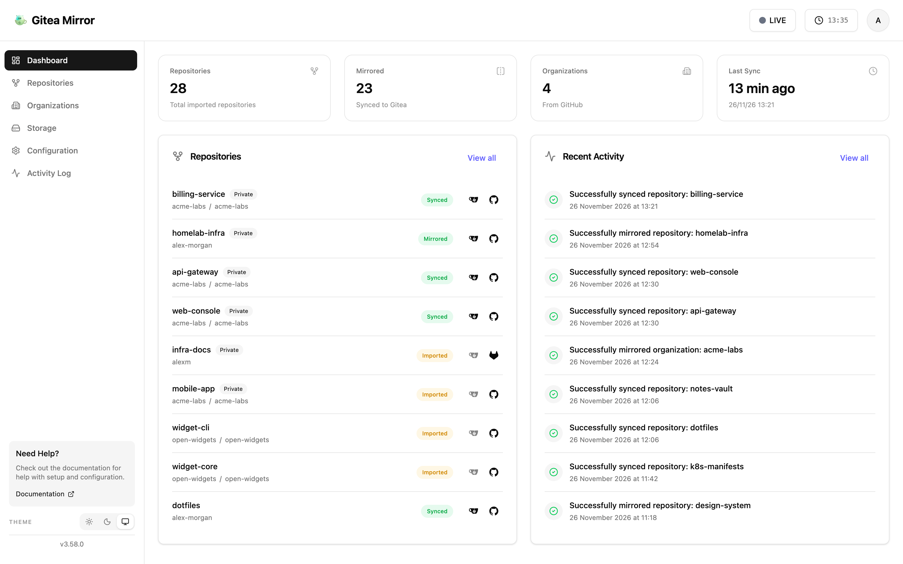
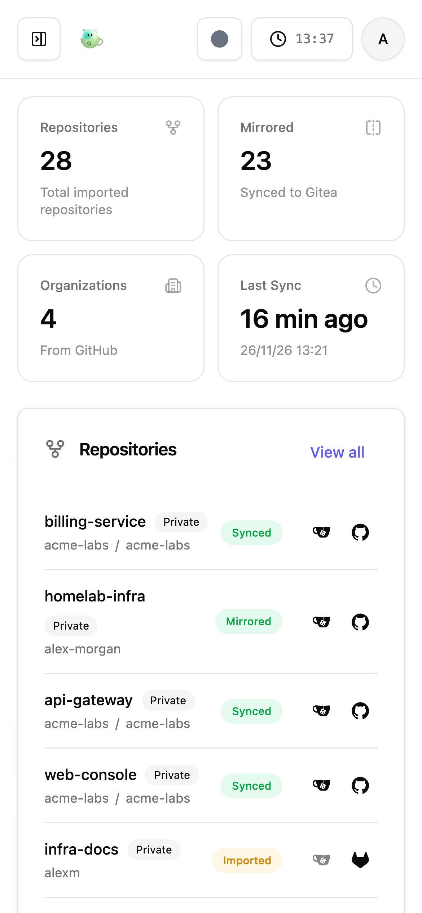
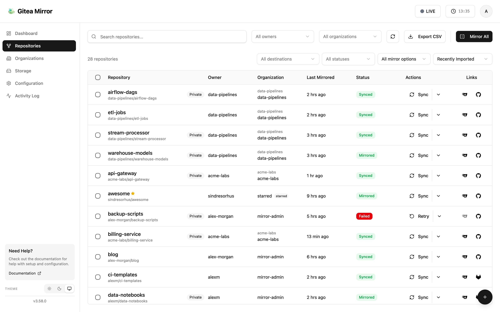
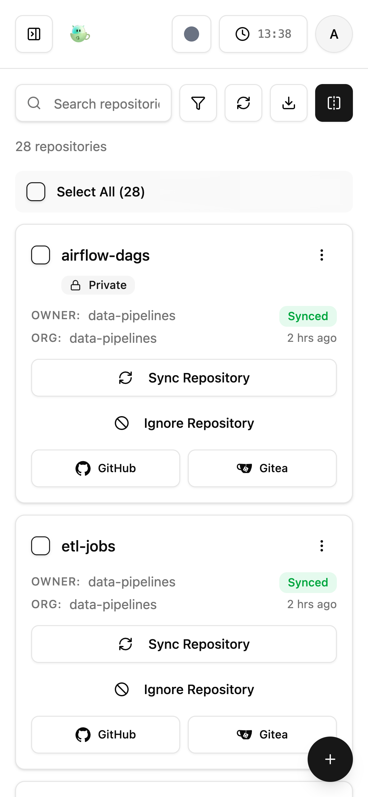

<p align="center">
  
  <h1>Gitea Mirror</h1>
  <p><i>Automatically mirror repositories from GitHub to your self-hosted Gitea/Forgejo instance.</i></p>
  <p align="center">
    <a href="https://github.com/RayLabsHQ/gitea-mirror/releases/latest"></a>
    <a href="https://github.com/RayLabsHQ/gitea-mirror/actions/workflows/astro-build-test.yml"></a>
    <a href="https://github.com/RayLabsHQ/gitea-mirror/pkgs/container/gitea-mirror"></a>
    <a href="https://github.com/RayLabsHQ/gitea-mirror/blob/main/LICENSE"></a>
  </p>
</p>

Gitea Mirror keeps a self-hosted copy of your repositories. Connect GitHub (or GitLab, Gitea, Forgejo or any git host), pick a Gitea or Forgejo server, and it mirrors your repositories, organizations and starred projects there, with issues, pull requests, releases, wiki and LFS if you want them, and keeps them in sync on a schedule.

📖 **[Documentation](https://gitea-mirror.raylabs.io/docs/)**

## Quick start

```bash
git clone https://github.com/RayLabsHQ/gitea-mirror.git
cd gitea-mirror
docker compose -f docker-compose.alt.yml up -d
```

Open http://localhost:4321 and create an account; the first one becomes the admin. Then connect a source and a destination on the **Configuration** page. The [Quickstart](https://gitea-mirror.raylabs.io/docs/quickstart/) walks through it, including the compose file to use without cloning.

<p align="center">
  
  
</p>

## Features

- Mirror your public, private and starred repositories and whole organizations, including public organizations you are not a member of
- Sources: GitHub, GitHub Enterprise and GitHub Apps, plus GitLab, Gitea, Forgejo and plain git hosts in beta ([Sources](https://gitea-mirror.raylabs.io/docs/sources/))
- Destinations: Gitea as pull mirrors, plus Forgejo, and GitHub or GitLab as push targets, in beta ([Destinations](https://gitea-mirror.raylabs.io/docs/destinations/))
- Issues, pull requests (as issues), labels, milestones, releases with assets, wiki and Git LFS, with filters and limits per organization and repository
- Mirror strategies to keep the source's structure, use one organization, or put everything under your user, plus a destination per organization or repository
- Scheduled syncs, discovery of new repositories, and cleanup that archives mirrors whose source is gone ([Cleanup and reconcile](https://gitea-mirror.raylabs.io/docs/cleanup-and-reconcile/))
- [Force-push protection](https://gitea-mirror.raylabs.io/docs/force-push-protection/): a snapshot, or your approval, before a sync rewrites history
- [Notifications](https://gitea-mirror.raylabs.io/docs/notifications/) through ntfy, Apprise, Gotify or a signed webhook
- Sign in with email and password, OIDC single sign-on, or a header from your reverse proxy ([Authentication](https://gitea-mirror.raylabs.io/docs/authentication/))
- A REST [API](https://gitea-mirror.raylabs.io/docs/api/) with API keys, and an [MCP server](https://gitea-mirror.raylabs.io/docs/mcp/) for AI assistants
- Live dashboard, activity log, storage overview and CSV export
- Tokens encrypted at rest with AES-256-GCM

## Install

| Method | Guide |
| --- | --- |
| Docker Compose | [Quickstart](https://gitea-mirror.raylabs.io/docs/quickstart/) |
| Plain `docker run` | [Deployment](https://gitea-mirror.raylabs.io/docs/deployment/#plain-docker-run) |
| Kubernetes with Helm | [Deployment](https://gitea-mirror.raylabs.io/docs/deployment/#kubernetes-with-helm) |
| Nix and NixOS | [Deployment](https://gitea-mirror.raylabs.io/docs/deployment/#nix-and-nixos) |
| Proxmox LXC | [Deployment](https://gitea-mirror.raylabs.io/docs/deployment/#lxc-on-proxmox) |
| Unraid | [Unraid guide](https://gitea-mirror.raylabs.io/use-cases/unraid-github-backup/) |
| Bare metal with Bun | [Deployment](https://gitea-mirror.raylabs.io/docs/deployment/#bare-metal-with-bun) |

The image is `ghcr.io/raylabshq/gitea-mirror`, built for amd64 and arm64. Before upgrading, see [Backups and upgrades](https://gitea-mirror.raylabs.io/docs/backups-and-upgrades/).

## Documentation

- [Configuration guide](https://gitea-mirror.raylabs.io/docs/configuration/) and [environment variables](https://gitea-mirror.raylabs.io/docs/environment-variables/)
- [Tokens and permissions](https://gitea-mirror.raylabs.io/docs/tokens/) for every source and destination
- [Repositories and organizations](https://gitea-mirror.raylabs.io/docs/repositories-and-organizations/) for day to day use
- [Reverse proxy and URLs](https://gitea-mirror.raylabs.io/docs/reverse-proxy/)
- [Troubleshooting](https://gitea-mirror.raylabs.io/docs/troubleshooting/) for the questions that come up most
- [Use cases](https://gitea-mirror.raylabs.io/use-cases/) such as backing up GitHub, moving to Gitea, or mirroring GitLab

<div align="center">
  
  
</div>

## Community projects

Built by the community on top of the [Gitea Mirror API](https://gitea-mirror.raylabs.io/docs/api/):

- [GiteaMirrorBot](https://github.com/MajMcCloud/GiteaMirrorBot) by [MajMcCloud](https://github.com/MajMcCloud): a Telegram bot that spots GitHub links posted in a group and, when you confirm, adds the repository or organization to Gitea Mirror and starts the mirror. It can also post notifications back into the group. Runs as a single binary or a Docker image.

## Contributing

Contributions are welcome. Read the [contributing guide](CONTRIBUTING.md) first; [docs/DEVELOPMENT_WORKFLOW.md](docs/DEVELOPMENT_WORKFLOW.md) covers the local setup. Report security issues privately through [GitHub security advisories](https://github.com/RayLabsHQ/gitea-mirror/security).

## License

GNU Affero General Public License v3.0 (AGPL-3.0), see [LICENSE](LICENSE).

## Star history

<a href="https://www.star-history.com/?repos=RayLabsHQ%2Fgitea-mirror&type=date&legend=top-left">
 <picture>
   <source media="(prefers-color-scheme: dark)" srcset="https://api.star-history.com/chart?repos=RayLabsHQ/gitea-mirror&type=date&theme=dark&legend=top-left&sealed_token=zodo-E2HH58BX1LXhjYFF1dKmophMxE1C-ho3bvwiiC1iFxC7MTeKTy-uQgcInXqQV6QF5oHXYjDoHhPdUOJNnlgjYmVqsCMTvLVrcFTD0DWKH6fvG6qC-xfXS_2bUWPt_ybnIsuoOoTWppmkCLlfTy0-_jpkHQOrTorh3Hbul43dUWUwJraXc2W6XHD" />
   <source media="(prefers-color-scheme: light)" srcset="https://api.star-history.com/chart?repos=RayLabsHQ/gitea-mirror&type=date&legend=top-left&sealed_token=zodo-E2HH58BX1LXhjYFF1dKmophMxE1C-ho3bvwiiC1iFxC7MTeKTy-uQgcInXqQV6QF5oHXYjDoHhPdUOJNnlgjYmVqsCMTvLVrcFTD0DWKH6fvG6qC-xfXS_2bUWPt_ybnIsuoOoTWppmkCLlfTy0-_jpkHQOrTorh3Hbul43dUWUwJraXc2W6XHD" />
   
 </picture>
</a>

## Support

- 🐛 [Report an issue](https://github.com/RayLabsHQ/gitea-mirror/issues)
- 💬 [Discussions](https://github.com/RayLabsHQ/gitea-mirror/discussions)
